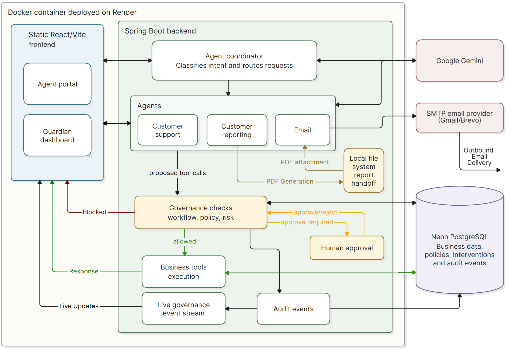

# AgentOps Guardian

AgentOps Guardian is a Spring Boot application that governs tool use by AI agents in customer workflows. It checks proposed actions against configured policies, the current workflow, and runtime risk before allowing execution.

Check out the application: [Governance Dashboard](https://agentguardian.onrender.com) · [Agent Coordinator Chat](https://agents-portal.onrender.com)

## Problem

AI agents can perform multi-step tasks using tools, including reading customer information and sending email. A per-tool permission check does not capture whether an action is appropriate in the context of earlier workflow steps. AgentOps Guardian evaluates tool proposals in their workflow context and records the decisions and outcomes.

## Architecture
Check out the [Architecture Page](https://agentguardian.onrender.com/architecture)



## Project structure

```text
agentops-guardian/
├── data/
│   └── reports/        # Generated PDF reports location
|
├── figures/
│   └── architecture.png
|
├── agent-portal/       # Agent coordinator chat frontend
├── frontend/           # Governance dashboard frontend
|
├── src/
│   ├── main/
│   │   ├── java/
│   │   │   └── com/agentops/guardian/
│   │   │       ├── agent/
│   │   │       ├── config/
│   │   │       ├── controller/
│   │   │       ├── coordinator/
│   │   │       ├── domain/
│   │   │       ├── governance/
│   │   │       ├── ingestion/
│   │   │       ├── repository/
│   │   │       ├── service/
│   │   │       ├── tool/
|   |   |       └──AgentOpsGuardianApplication.java
|   |   |
│   │   └── resources/
│   │       ├── application.properties
│   │       └── prompts/
|   |
│   └── test/
│       └── java/
|
├── HELP.md
├── LICENSE
├── pom.xml
├── mvnw
├── mvnw.cmd
└── README.md
```

## Technology and deployment

- Java 25, Spring Boot 4, Spring AI 2, and Maven
- React, TypeScript, and Vite for both frontends
- Google Gemini for intent and agent model calls
- Spring Data JPA with PostgreSQL; the deployed database is Neon
- Dockerized backend on Render; static frontends are deployed separately
- Email is sent over SMTP; the deployment uses Brevo as its SMTP provider

## Current scope and limitations

- Configurable policies, workflow rules, and deterministic risk assessment are separate governance checks. Risk does not override a policy block.
- Approval is tied to a specific proposed tool action; it is not a reusable permission.
- The email payload or content is not governed.
- Conversation history and pending task continuation are held in application memory. A restart can prevent a pending task from resuming.
- Generated analytical PDFs are stored in the backend runtime filesystem and used for report handoff.
- The backend currently has no authentication layer, and the declared CORS origins property is not yet connected to an active CORS configuration. These should be addressed before relying on public deployment access.
- The project is a working MVP, not a complete production governance platform.

## Running locally

Set the required database and Gemini environment variables (`DB_URL`, `DB_USERNAME`, `DB_PASSWORD`, and `GEMINI_API_KEY`) before starting the backend:

```powershell
.\mvnw.cmd spring-boot:run
```

Run either frontend from its directory:

```powershell
npm install
npm run dev
```

Configure the frontend API base URL for the backend address. To enable email, configure the SMTP settings and `EMAIL_ALLOWED_RECIPIENTS`; recipients outside the allowlist are rejected.

## Main API routes

- `POST /api/agent-coordinator/run` — submit a user request
- `GET /api/workflows` and `GET /api/workflows/{workflowId}` — read workflow audit trajectories
- `/api/policies` — list, create, and update configurable policies
- `/api/interventions` — review, approve, or reject pending interventions
- `GET /api/events/stream` — receive live governance events using Server-Sent Events (SSE)

## Future work

Potential next steps include authentication and role-based access, active CORS configuration, durable conversation and pending-task storage, and additional deployment hardening.
